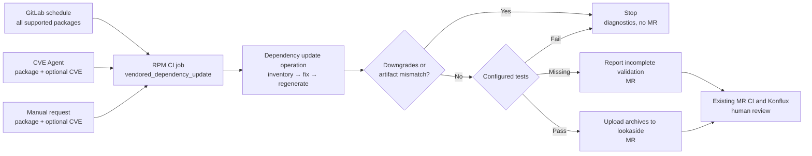

- **Status:** Proposed
- **Date:** 2026-11-17
- **Author:** Juraj Stibrany
- **Jira:** [HUM-12862][hum-12862]

## Context

Many RPM packages in [`rpms`][rpms-repo] ship dependencies that are vendored or
otherwise embedded at build time. Go packages vendor modules into a separate
archive, and other ecosystems use equivalent lockfiles and caches. The shipped
dependency set is therefore not necessarily the dependency set declared by the
upstream application release.

When a vulnerability affects such a dependency, the current scheduled update
flows do not select a fix, [`upstream_update_multi_mr.sh`][rpms-upstream] only
applies an update when a newer **application** version exists. It does not update
an embedded/vedonred dependency within the current application version.

Fixes are instead applied by hand. The repository already contains the
necessary machinery: `gorget` source pipelines regenerate vendored sources,
`go-vendor-tools` applies declared dependency overrides, generated archives are
uploaded to the lookaside cache, and changes could be submitted through the
[workqueue service][workqueue-adr] as MRs. A human currently has to decide that
a dependency needs updating and wire those steps together per package.

Leaving this manual has two costs. Remediation waits for an upstream application
release even when a compatible fixed dependency exists, and whether a given CVE
is handled depends on individual tracker triage rather than a repeatable check.

Manual dependency overrides carry their own risk. Overrides are exact pins, not
minimum versions, so a stale pin can hold a dependency below a later upstream
requirement and cause unexpected downgrades of other dependencies. Any
automation must inspect the resolved dependency set, not only the requested
change.

### Scope

This ADR covers security-driven updates to dependencies embedded in RPM
packages while the application version stays unchanged.

It does not cover:

- Application version updates, dist-git synchronization or package rebuilds.
  Those retain their existing flows.
- Blanket upgrades of all dependencies to their latest releases.
- Marking CVEs fixed. That remains with the existing tracker and advisory
  processes.

## Decision

Add one reusable dependency-update operation to the `rpms` repository and invoke
it from **RPM CI**. Do not add a new service, queue or database.

### Execution model

A dedicated `vendored_dependency_update` job runs the operation on the RPM CI
runner, reusing the checkout, runner image, OIDC credentials and lookaside
upload path that the existing update jobs use.

The job has two triggers:

- A GitLab schedule checks all packages with supported embedded dependencies,
  mirroring how scheduled application updates already run.
- A targeted request checks one package, optionally for one CVE. The
  [`hummingbird-cve-agent`][cve-agent] in `tools` could use this trigger when an
  investigation identifies a fixable embedded dependency. A human can make the
  same request when resolving a CVE by hand as well.

Targeted requests pass a package and optional CVE, never arbitrary commands or
repository revisions. The job resolves the source commit itself. Enabling this
requires a narrow addition to the workflow rules in [`rpms` CI][rpms-ci], which
today do not admit API-triggered pipelines. Only this job should be exposed.

### Dependency update operation

The operation supports an all-package check and a single-package update. For a
package it:

1. Resolves the source revision and the dependency inventory that the package
   actually builds, preferring generated artifacts or an SBOM over the upstream
   manifest.
2. Finds an advisory-backed fixed version for the affected dependency.
3. Applies the update through the package's existing generation configuration
   and regenerates source and vendor artifacts together.
4. Compares the resolved dependency set before and after, rejecting unexpected
   downgrades, unsupported layouts and mismatched source or vendor metadata.
5. Runs the tests configured for that package. Undefined or missing test
   coverage is reported as incomplete validation, never as success.
6. Uploads generated archives to the lookaside cache and submits the repository
   changes as an MR.

Every package change remains a normal MR validated by existing MR CI and
Konflux. Dependency updates use their own source branch and idempotency key, and
are reported rather than merged when they conflict with an open package change.
the existing [workqueue MR API][workqueue-mr] already supports that.

### Initial ecosystem

Go is supported first because its generation, override and artifact paths
already exist and are in use. Packages using other ecosystems are inventoried
and reported as unsupported until their generation and test workflows are
defined. The orchestration, trigger contract and validation reporting are
ecosystem-neutral; only the update mechanics are ecosystem-specific.

## Consequences

- Embedded dependency fixes no longer have to wait for an upstream application
  release when a compatible fixed dependency is available.
- Scheduled checks make remediation independent of whether an individual Jira
  tracker prompts it.
- The expensive work stays in RPM CI, and MR lifecycle, retries and build
  validation reuse the existing workqueue and Konflux paths.
- The first version depends on GitLab CI latency and serialized runs. That is
  acceptable while the number of affected packages is small; a dedicated worker
  can be considered if throughput becomes a constraint.
- Inventory accuracy determines correctness. Checking upstream manifests alone
  would miss overrides and other generation-time changes.
- Automation that changes dependencies can break working packages even when a
  build succeeds. Package-specific tests and explicit incomplete-validation
  reporting are required safeguards.
- If test recipes are absent for most packages, many updates will correctly
  stop for human review. The benefit then comes from earlier detection and
  prepared changes, not from unattended remediation.

## Open Questions

- Which advisory source drives discovery, and how should Go module advisories
  and ecosystem-agnostic CVE feeds be reconciled?
- Should inventory come from published SBOMs, generated build artifacts, or both?
- What constitutes an acceptable test recipe per ecosystem, and who owns it?
- How often should the all-package schedule run, and how should advisory updates
  trigger rechecks between runs?
- Do generated archives remain retrievable from the lookaside cache for
  verifying historical shipments?

[hum-12862]: https://redhat.atlassian.net/browse/HUM-12862
[cve-agent]: https://gitlab.com/redhat/hummingbird/tools/-/tree/main/hummingbird-cve-agent
[rpms-ci]: https://gitlab.com/redhat/hummingbird/rpms/-/blob/main/.gitlab-ci.yml
[rpms-repo]: https://gitlab.com/redhat/hummingbird/rpms
[rpms-upstream]: https://gitlab.com/redhat/hummingbird/rpms/-/blob/main/ci/upstream_update_multi_mr.sh
[workqueue-adr]: 0002-ai-assisted-sdlc-workqueue.md
[workqueue-mr]: https://gitlab.com/redhat/hummingbird/tools/-/tree/main/workqueue-service
