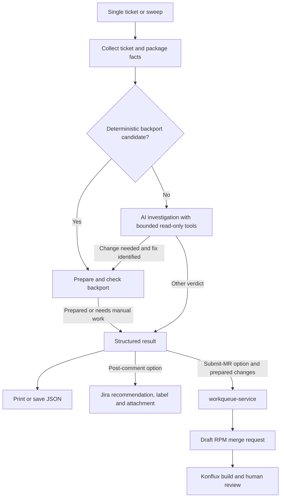

- **Status:** proposed
- **Authors:** Juraj Stibrany
- **Created:** 2026-10-06
- **Last updated:** 2026-10-06

## Summary

The CVE investigation agent investigates Hummingbird security Jira tickets labeled `cve-needs-attention`
or `upstream-fix-available`. The agent collects facts about the ticket and shipped
package, uses deterministic checks where possible, and uses AI for questions those checks
cannot answer. When a backport can be prepared, it submits structured file changes to the
`workqueue-service`, which creates and manages the merge request.

This agreement describes the `hummingbird-cve-agent` workflow and its ownership
boundaries. The agent's deterministic code collects facts, prepares changes, and
performs requested reporting and handoff. Package builds run in Konflux, and backports
require human review before merge.

## Motivation

The existing CVE analysis job resolves cases it can handle deterministically. Some tickets
still need investigation to determine whether a vulnerable component ships in a package,
whether the shipped source contains a fix, or whether an upstream patch can be backported.

The agent handles this work without replacing CVE analysis or the manual `/cve` workflow.
It reuses their facts and conventions, records its reasoning, and prepares reviewable
changes rather than making package or release decisions on its own. As the agent becomes
more reliable, it may be allowed to close security tickets when high-confidence analysis,
backed by evidence, shows that the package is not affected or already fixed.

## Impacts

### User facing

The CLI can investigate one ticket or sweep all eligible tickets. Results are printed or saved
locally by default. Explicit options enable a Jira recommendation comment and analysis attachment,
submission of a draft fix MR, or both. Reviewers see the evidence, proposed changes, and
checks still needed.

### Repositories

- [x] tools/ — CVE agent, shared CVE analysis helpers, model adapter, and workqueue-service.
- [x] rpms/ — patch, spec, and metadata changes submitted as MRs.
- [x] infrastructure/ — scheduling and credentials for automated runs.
- [x] documentation/ — this agreement and user-facing documentation.
- [ ] gorget/
- [ ] containers/
- [ ] skills/

## Design

### Ownership and flow

The CVE agent owns investigation and backport preparation. It can submit MR work items,
but does not hold GitLab write credentials or create MRs directly. Workqueue-service owns
GitLab writes and the MR lifecycle. Konflux verifies the package build; a human reviews
whether the fix is appropriate.

### Ticket scope and collected facts

The agent accepts tickets labeled `cve-needs-attention` or `upstream-fix-available`.
Embargoed tickets are rejected before external package lookups or model calls. Sweeps
search open HUM Security tickets and skip tickets already carrying the agent's analysis
attachment.

Collection reads the Jira ticket, existing CVE analysis, and a bounded selection of its
comments. It also gathers the shipped package NVR and available SBOM data. Investigation
tools can inspect package files, checksum-pinned source archives, and upstream fixes.
Ticket and package identifiers are supplied by deterministic code, not chosen by the model.

### Deterministic checks & AI investigation

An eligible ticket with an **unambiguous** upstream fix and an existing affectedness assessment
can take the deterministic backport path without a model call. All other tickets use AI to
investigate affectedness and identify relevant evidence. That decision is made
from the collected facts at runtime.

The model can request bounded, read-only tools. It cannot run arbitrary shell commands or
perform external writes. Its output is parsed into the result contract; it cannot supply
the ticket identity, package identity, or MR file actions. It may identify an upstream
commit, but deterministic code fetches and checks the patch before preparing changes.

Results use the following verdict vocabulary: Verdict labels `needs_change`, `not_affected`,
`already_fixed`, `no_upstream_fix`, `needs_human`, or `error`. Verdicts also include confidence,
a summary, sources, and investigation steps.

### Backport preparation and checks

Fix preparation is limited to backports. Version updates remain in the existing RPM update
workflow. The code prepares patch files, wires them into the spec, bumps the
release using RPM repository conventions, and updates modification metadata where needed.
The result carries base64-encoded `file_actions` and a commit message.

Each investigation uses an ephemeral, uncredentialed RPM repository clone, opened only
when needed and shared by source inspection and backport preparation. Source archives are
checked against the repository's recorded checksums. Supported spec preparation is checked
with the local patch engine; the agent does not execute spec scriptlets or run package builds.

If preparation is unsupported or a patch cannot be applied, the result records the limit
and does not carry submission-ready changes. A failed backport does not erase a supported
finding that the package needs a change.

Local checks establish that a supported backport can be prepared. Konflux checks the
package build, and human review assesses whether the patch addresses the CVE. There is
no separate model verifier in the current workflow.

### Reporting and MR handoff

`--post-comment` and `--submit-mr` are independent and off by default. Jira reporting uses
the shared CVE analysis client to post a recommendation and attach
`<TICKET>-cve-agent-analysis.json`. Duplicate recommendations do not produce another
comment and attachment. Reporting does not close the ticket or publish an advisory.

Jira reporting also applies the labels corresponding to the result verdict:
`needs_change`, `not_affected`, `already_fixed`, `no_upstream_fix`, `needs_human`,
or `error`. The dashboard uses these labels to identify tickets analyzed by the CVE
agent and display the outcome. A new analysis replaces the previous agent verdict label
while preserving existing scope and lifecycle labels. Labeling remains an explicit Jira
write; local-only runs do not change tickets. The labels record the agent's recommendation,
not a Jira resolution or confirmation that a fix has shipped.

MR submission requires prepared file actions and a commit message. The agent sends them
to workqueue-service's `/api/work-items/mr` endpoint with the project, source branch,
description, and related ticket. The ticket-derived idempotency key identifies repeated
submissions. Requests create draft MRs and leave automatic merge disabled.

Workqueue-service validates the requested paths against its blocklist and uses its own
GitLab credentials to create or update the MR. It applies the `managed-by::workqueue`
label and tracks MR and pipeline events. The agent does not push a sandbox branch or hand
over a git ref.

### Credentials and untrusted inputs

Jira and workqueue credentials belong to deterministic collection and write code. They
must not be included in model context or sandbox subprocess environments. Authentication
for model calls is handled by the shared model adapter.

Ticket text, source files, upstream content, and model output are untrusted inputs.
Read tools enforce their URL, path, size, and call limits. A model-selected fix must pass
the same deterministic preparation checks as a fix from existing CVE analysis. Model
confidence does not bypass path validation, CI, or human review.

## Risks and open questions

- Source preparation supports a subset of RPM spec patterns. Unsupported conditional
  patches and preparation modes remain human work until support for these formats is added
  and tested.
- Schema validation and patch application do not prove affectedness or semantic coverage.
  Evidence collection and verdict validation still need stronger handling of incomplete
  searches, unavailable data, and source-only dependencies.
- Read-only source inspection reduces risk but does not make upstream content trustworthy.
  Review remains necessary even when a backport applies cleanly and the build succeeds.

## Implementation notes

The implementation lives in `tools/hummingbird-cve-agent/`; its user documentation is
`tools/documentation/hummingbird-cve-agent.md`. Workqueue path validation and GitLab
writes are implemented in `tools/workqueue-service/workqueue_service/mr/executor.py`.

Remaining work includes scheduled investigation and handoff, historical ticket context,
broader spec support, and bounded patch adaptation, including rework after Konflux failures.

This agreement records the design. User-facing documentation can be updated from it;
changes to that documentation do not change this agreement.
